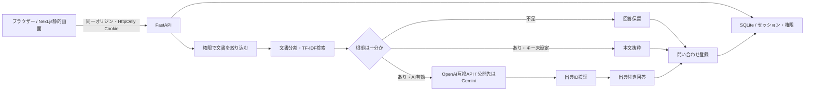

# 構成・セキュリティ

## なぜ単一サービスか

Next.jsを静的エクスポートし，FastAPIから配信する．同一オリジンでCookieを扱えてCORSの複雑さを避けられ，公開アプリの実行サービスを一つにできる．Next.jsのサーバーAPIは使わず，認証・検索・操作はPython APIが担う．

Sitesのサーバー実行環境はCloudflare Workersであり，このFastAPIアプリをそのまま動かす構成には適さない．Pythonを説明できる成果物という目的を維持し，公開先はRenderを使用する．

公開デモではGeminiのOpenAI互換APIへ直接接続し，追加のゲートウェイを実行しない．LiteLLM Proxy経由の接続はローカル再現用の任意構成として保持し，公開環境での実証とは区別する．

## 認証・認可

- パスワードはランダムsalt付きscrypt．DBに平文を保存しない．
- ランダム256bitセッションIDをCookieに，SHA-256ハッシュだけをDBに保存．
- HttpOnly / SameSite=Lax．公開時はSecureとHSTSを有効にする．
- 変更APIにはCSRFトークン．すべての変更要求でOrigin / Sec-Fetch-Siteも確認．
- 認証時にセッションをローテーション．ログアウト時はDBから失効．
- ロールはサーバーのユーザー・セッションから確定．クライアントが質問にroleを追加しても422で拒否．
- 社員向け文書のみを候補にしてから検索・Embedding・モデルへの入力を行う．
- デモ管理者は独立セッション．デモ参加者に共有資料の書き込み権限や他の訪問者の操作ログを与えない．
- ブラウザーは文字列をReactで表示し，モデル出力をHTMLとして挿入しない．

## RAGと評価上の注意

既定の検索は学習済みの意味Embeddingではなく，文字bigram TF-IDFコサイン類似度．簡潔な原文と見出しを検索する．任意の `/embeddings` 接続時はTF-IDF候補の再順位付けを行う．根拠判定は類似度・重複文字列に基づくため，難しい言い換えや複合質問で失敗する．

モデルへ渡す資料は命令ではなくデータとして区切る．代表的な指示上書き要求は保留する．回答JSONに含まれる出典IDを許可済み候補と照合し，未知ID・欠落・不正JSONは保留/抜粋とする．ただし，IDの整合性だけで回答内容の正しさを保証できない．文書内攻撃に対する網羅的な防御や意味上の完全な根拠検証は未達成．

## ログと保持

監査ログはevent / role / demo / timestampのみ．質問本文・メール・パスワード・キー・トークンを記録しない．会話と問い合わせ本文は，引き継ぎの機能上必要なデータとして別テーブルに保存する．

デモ会話はログアウトで削除．取り残したデモ問い合わせと会話は24時間を超えた後，次回の認証/起動で整理する．監査ログ・利用履歴は30日．通常問い合わせの削除機能は未実装なので，個人情報を扱う運用には使わない．

## 無料公開の限界

無料Renderのファイル領域は一時的．DB・セッション・上限カウンター・追加文書が再起動でリセットされる．「30日保持」はDBが存続している期間の上限で，無料公開の再起動を越える保証はない．永続DBは次段階で導入する．

AI利用回数は同一DB内で原子的に予約し，プロバイダー失敗も数える．ただし無料Renderの再起動でカウンターが消えるため，**課金防止の最終制御はプロバイダー側で有料枠を無効にすること**．生成費用の概算は設定単価と報告トークン数のみで，Embedding・税・ゲートウェイ・ホスティング費を含まない．
